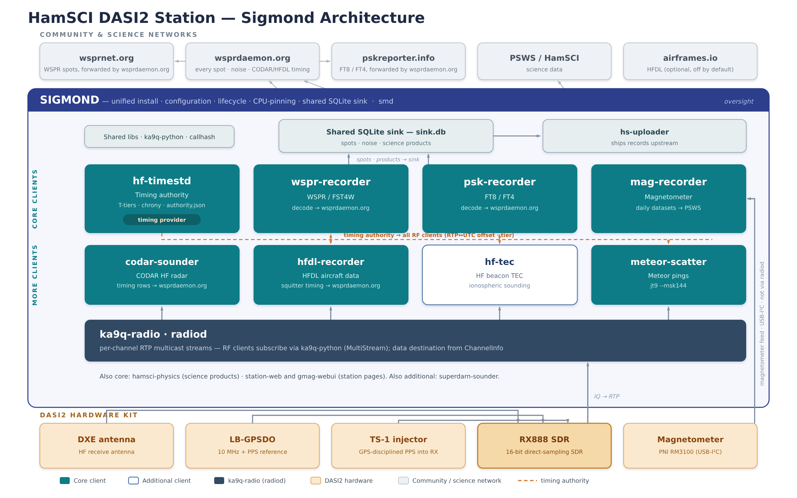

# Sigmond

**SigMonD** (Signal Monitor Daemon) installs, coordinates and looks after
the [HamSCI](https://hamsci.org/) SDR observation suite on a station.

A station is a [ka9q-radio](https://github.com/ka9q/ka9q-radio) receiver
on an RX888 SDR, disciplined by a GPSDO and time-injected by a TS-1, plus a
magnetometer: the kit of **DASI2**, the NSF-funded *Distributed Array of
Small Instruments, Track 2*.  Independent clients record what the station
hears (WSPR, FT8/FT4, HF time standards, the magnetic field, CODAR, HFDL,
beacon TEC, meteor scatter), and sigmond handles what they share.
[Why sigmond?](docs/WHY-SIGMOND.md) explains the difference it makes.

## Start here

All documentation opens from one front door, **[docs/README.md](docs/README.md)**.
Pick the door that matches you:

| You | Start at |
|---|---|
| install a station | [Proxmox USB image](https://github.com/HamSCI/sigmond-proxmox/blob/main/INSTALL.md) for a dedicated mini-PC ([why Proxmox?](docs/WHY-PROXMOX.md)), or [bare metal](docs/install-bare-metal.md) on a Linux machine you already run |
| host a station | [Operator guide](docs/operator/README.md) |
| want a signal recorded | [Scientist guide](docs/scientist/README.md) |
| work on the code | [CONTRIBUTING.md](CONTRIBUTING.md), then the [Contributor guide](docs/contributor/README.md) |
| look after many stations | [Administrator guide](docs/admin/README.md) |

Also:

- [The components](docs/COMPONENTS.md): every client and library, each with its own documentation.
- [smd commands, monitoring and debugging](docs/COMMANDS.md).
- [Hardware shopping list](docs/hardware/shopping-list.md): what a station needs.
- [Every page, by audience](docs/INDEX.md).

## Project

- **Authors:** Michael Hauan (AC0G), Rob Robinett (AI6VN)
- **License:** MIT (see [LICENSE](LICENSE))
- **Part of:** [HamSCI](https://hamsci.org/), Ham Radio Science Citizen Investigation
